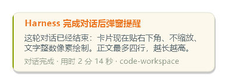
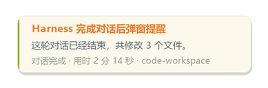
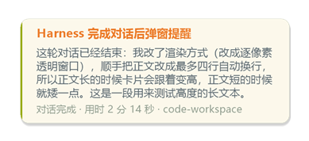
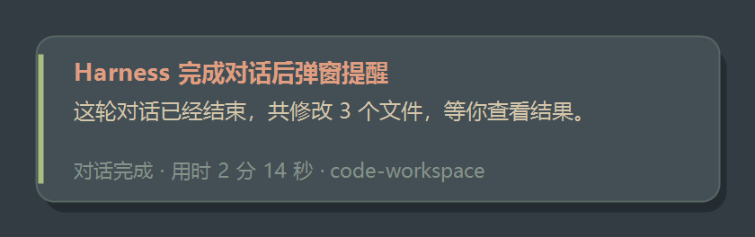
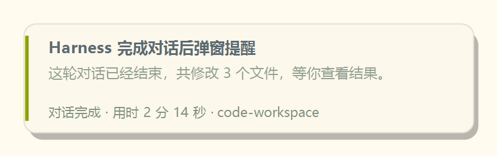

# 对话完成提醒（dsh-turn-notify）

> DeepSeek Harness 的宿主插件：一轮对话结束、或卡住等你确认时，在 Windows 屏幕右下角弹出一张**跟随当前主题**的提示卡片，并播放系统通知音。



---

## 它解决什么

Harness 跑一轮长对话常常要几分钟。你把它放到后台去做别的事，回来时不知道它到底结束了没有——没有声音、没有弹窗、没有任务栏提示。

这个插件补上这一环：回合结束的那一刻，右下角浮起一张卡，一眼能看到：

- 是哪条会话（会话标题）
- 结果是什么（摘要，最多四行）
- 花了多久、在哪个工作区（脚注）
- 同时响一声 Windows 通知音

它**不写会话日志、不进模型上下文、不改 Harness 界面**——只是一个旁路观察者。

## 效果

| 短摘要 | 长摘要（自动变高） |
|---|---|
|  |  |

深色主题下长这样：



主题跟随不是"深色一套、浅色一套"写死的。卡片的底色、描边、标题/正文/脚注颜色、字体族和字号，全部来自**运行时从页面读到的真实主题 token**，所以换主题、切深浅、装第三方主题插件（如 Everforest）、甚至主题插件运行时改色，下一张卡片就跟着变：



## 交互

| 动作 | 效果 |
|---|---|
| 出现 | 从下方 4px 浮起 + 淡入（约 180ms） |
| 鼠标悬停 | 整张卡上浮 2px，阴影留在原位（有抬起感） |
| 单击 | 快速淡出关闭 |
| 自动关闭 | 完成卡 8 秒；等待卡 20 秒 |
| 抢焦点 | 从不抢——你正在别的窗口打字不会被吃键 |
| 层级 | 始终压在 Harness 之上，被别的窗口盖住会自动抢回来 |

## 触发规则

| 场景 | 是否提醒 |
|---|---|
| 回合正常完成（`turn/end` + `completed`） | 提醒 |
| 回合出错、输出被截断、被阻止 | 提醒（红色/琥珀色条） |
| 你自己点了停止 / 会话被 fork | 不提醒 |
| 回合时长 < 30 秒 | 不提醒（可配为 0） |
| 子代理（subagent）的回合 | 不提醒 |
| Harness 窗口在前台、且正显示这条会话 | 不提醒（精确版不打扰） |
| 需要你批准 / 需要你回答问题 | 立刻提醒，20 秒后自动消失 |

## 安装

前置：Windows + DeepSeek Harness，profile 里已启用 `webServer`（默认 Web 版都有）。

```bash
# 在 Harness 里执行，让插件管理器把该目录装进当前 profile
plugin_manager install_bundle  D:\path\to\dsh-turn-notify
```

装完后**刷新一次页面**（客户端半边要加载后才会开始上报主题与焦点）。

## 配置

改 profile 的 `cordis.patch.yml` 里这一行（或直接改插件自带的 `cordis.patch.yml` 再重装）：

```yaml
- id: turn-notify
  name: '@local/dsh-turn-notify'
  config:
    enabled: true
    minTurnSeconds: 30     # 短于这个秒数不提醒（0 = 每轮都提醒）
    seconds: 8             # 完成卡停留秒数
    waitingSeconds: 20     # 等待卡停留秒数
    sound: true            # 系统通知音
    soundFile: Windows Notify System Generic.wav
    skipWhenFocused: true  # 你正看着这条会话时不打扰
    maxStack: 3            # 最多同时叠几张
    width: 340             # 卡片宽度（高度按内容自适应）
```

宿主侧的改动（`index.js`、配置）需要重启 Harness 生效；`notify.ps1` 的改动下次弹窗就生效（每次都是新进程）。

## 目录

```
dsh-turn-notify/
├── index.js            宿主插件：事件监听、过滤、组卡、起进程、HTTP 状态通道
├── client.js           浏览器半边：上报主题色值 / 焦点 / 当前可见会话
├── notify.ps1          Windows 提示卡：WinForms + 逐像素透明窗口 + GDI+ 绘制
├── cordis.patch.yml    插入配置行的 bundle patch
├── locale/{zh,en}.json 插件页里的标题与描述
├── icon.svg            插件图标
└── docs/
    ├── 01-设计.md      需求、约束、架构与关键决策
    ├── 02-开发日志.md  十轮迭代的全过程与踩过的坑
    └── 03-验收清单.md  怎么验收、已知限制
```

## 已知限制

- **只在 Windows 可用**（WinForms + PowerShell 5.1）。
- 全屏独占的游戏/视频下，系统可能不渲染置顶小窗（通常正是你想要的）。
- 多显示器固定落主屏右下角，暂不支持"跟随 Harness 窗口所在显示器"。
- 卡片窗口是独立进程，**截图工具（BitBlt）抓不到它**，只能用进程内 `-DumpFrame` 导出验证。
- 卡片不进 Windows 通知中心，关掉就没了。

## 版本

见 [CHANGELOG.md](CHANGELOG.md)。当前 **v1.0**。
